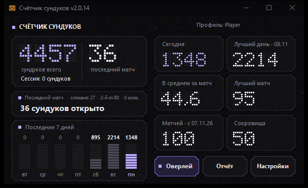
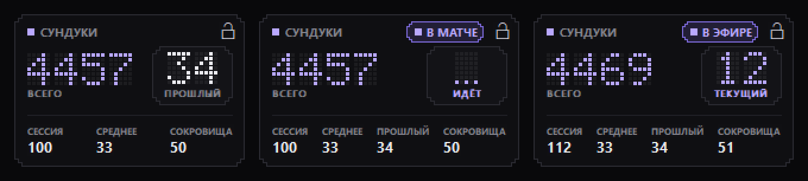
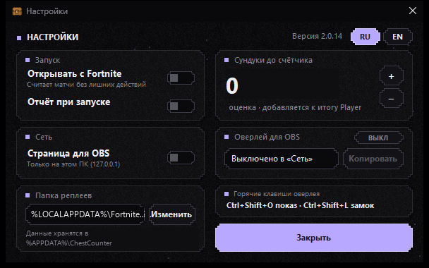
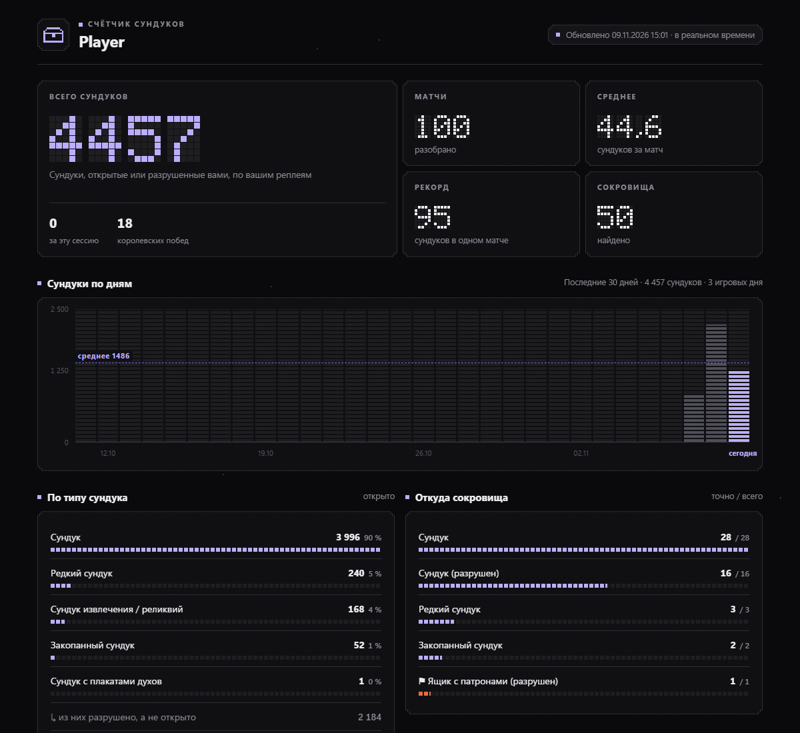

[Русский](README.md) · **English**

# Fortnite Chest Counter

Counts the chests you open in Fortnite by reading your replay files. Shows an overlay on top of the game and an HTML report with stats.

This is a fork of [xdoofy92/ChestCounter](https://github.com/xdoofy92/ChestCounter) with a Russian and English interface and no internet access.

[](https://github.com/flexeykinDev/ChestCounter/releases/latest/download/ChestCounter.exe)

**[Download ChestCounter.exe](https://github.com/flexeykinDev/ChestCounter/releases/latest/download/ChestCounter.exe)** · Windows 10 / 11 · no install · [all versions](https://github.com/flexeykinDev/ChestCounter/releases)

Windows may show "Windows protected your PC" because the exe is not signed: "More info" → "Run anyway". If you would rather not trust a prebuilt file, build it yourself (see "Building").





## Changes in this fork

- Russian and English interface. Russian by default, English when Windows is in English. Switch it in the settings (RU / EN) or with `--lang ru|en`.
- No auto-update. The original checked GitHub and could download and replace its own exe. This version makes no network connections at all.
- New look: dark pixel interface, dot-matrix figures, one accent colour. Window, overlay, report and OBS page share the same style.
- The OBS page (`http://localhost:7373/`) is off by default. Turn it on in the settings; it only listens on 127.0.0.1.



## How it works

Fortnite saves a replay of each match in `%LOCALAPPDATA%\FortniteGame\Saved\Demos`. The tool reads these files (read-only) after the match. It does not touch the game process or game files and needs no Epic account.

Replays must be on in Fortnite: Settings → Game → Replays.

Data is stored in `%APPDATA%\ChestCounter`. The Report button opens the stats in your browser:



## Security: check it in the code

No promises here, just lines of code and commands you can run yourself. Links point to commit [`5cb5348`](https://github.com/flexeykinDev/ChestCounter/tree/5cb5348a64477744a83e97262e7ed5ab1dd4083c), so they stay valid after later changes.

| What | How it works | Where in the code |
|---|---|---|
| Internet | No outgoing connections. The original auto-update was removed entirely. | [removal commit](https://github.com/flexeykinDev/ChestCounter/commit/fb31696) |
| OBS server | The only network code. Listens on `127.0.0.1` only, answers 403 to requests from other sites, off by default. | [ObsServer.cs#L33](https://github.com/flexeykinDev/ChestCounter/blob/5cb5348a64477744a83e97262e7ed5ab1dd4083c/src/ChestCounter/ObsServer.cs#L33), [#L59-L61](https://github.com/flexeykinDev/ChestCounter/blob/5cb5348a64477744a83e97262e7ed5ab1dd4083c/src/ChestCounter/ObsServer.cs#L59-L61), [#L104-L108](https://github.com/flexeykinDev/ChestCounter/blob/5cb5348a64477744a83e97262e7ed5ab1dd4083c/src/ChestCounter/ObsServer.cs#L104-L108), [Monitor.cs#L94](https://github.com/flexeykinDev/ChestCounter/blob/5cb5348a64477744a83e97262e7ed5ab1dd4083c/src/ChestCounter/Monitor.cs#L94) |
| Reading files | Replays are opened read-only. No other files outside its own folder are read. | [Tracker.cs#L372](https://github.com/flexeykinDev/ChestCounter/blob/5cb5348a64477744a83e97262e7ed5ab1dd4083c/src/ChestCounter/Tracker.cs#L372), [FortniteReplayReader.cs#L30](https://github.com/flexeykinDev/ChestCounter/blob/5cb5348a64477744a83e97262e7ed5ab1dd4083c/lib/FortniteReplayReader/FortniteReplayReader.cs#L30) |
| Writing files | Only to its own folder `%APPDATA%\ChestCounter`. The Windows user name is replaced with `<user>` in `errors.log`. | [Models.cs#L202](https://github.com/flexeykinDev/ChestCounter/blob/5cb5348a64477744a83e97262e7ed5ab1dd4083c/src/ChestCounter/Models.cs#L202), [ErrorLog.cs#L40](https://github.com/flexeykinDev/ChestCounter/blob/5cb5348a64477744a83e97262e7ed5ab1dd4083c/src/ChestCounter/ErrorLog.cs#L40) |
| The game | Only checks by name whether `FortniteClient-Win64-Shipping` is running. It never touches the game's memory. | [FortniteWatch.cs#L26](https://github.com/flexeykinDev/ChestCounter/blob/5cb5348a64477744a83e97262e7ed5ab1dd4083c/src/ChestCounter/FortniteWatch.cs#L26) |
| Starting programs | Starts only itself (the "Open with Fortnite" background mode) and opens `report.html` in the browser. | [FortniteWatch.cs#L81](https://github.com/flexeykinDev/ChestCounter/blob/5cb5348a64477744a83e97262e7ed5ab1dd4083c/src/ChestCounter/FortniteWatch.cs#L81), [#L143](https://github.com/flexeykinDev/ChestCounter/blob/5cb5348a64477744a83e97262e7ed5ab1dd4083c/src/ChestCounter/FortniteWatch.cs#L143), [MainForm.cs#L396](https://github.com/flexeykinDev/ChestCounter/blob/5cb5348a64477744a83e97262e7ed5ab1dd4083c/src/ChestCounter/MainForm.cs#L396) |
| Registry | One value, `HKCU\...\CurrentVersion\Run\ChestCounter`. Created only when "Open with Fortnite" is on, removed when it is turned off. | [FortniteWatch.cs#L49-L61](https://github.com/flexeykinDev/ChestCounter/blob/5cb5348a64477744a83e97262e7ed5ab1dd4083c/src/ChestCounter/FortniteWatch.cs#L49-L61) |
| Keyboard | Two shortcuts registered with `RegisterHotKey`. No keyboard hooks, no keystroke capture. | [NativeOverlay.cs#L261-L262](https://github.com/flexeykinDev/ChestCounter/blob/5cb5348a64477744a83e97262e7ed5ab1dd4083c/src/ChestCounter/NativeOverlay.cs#L261-L262) |
| System calls | Only `user32`, `gdi32`, `kernel32` and `dwmapi`, for windows, drawing, the console and efficiency mode. The `kernel32` calls are `GetConsoleWindow`, `AllocConsole`, `AttachConsole`, `GetStdHandle`, `GetFileType`, `GetCurrentProcess`, `SetProcessInformation` and `GetModuleHandleW`. | command 5 below |
| Third-party code | Nothing is downloaded or loaded at run time, and there are no encrypted or base64 blobs. The only package is Microsoft's `Microsoft.Extensions.Logging.Abstractions`. The replay parser matches [Shiqan/FortniteReplayDecompressor@76f74c1](https://github.com/Shiqan/FortniteReplayDecompressor/tree/76f74c1), with every difference listed in [PATCHES.md](lib/PATCHES.md). The `DynamicMethod` in [NetFieldParser.cs#L134](https://github.com/flexeykinDev/ChestCounter/blob/5cb5348a64477744a83e97262e7ed5ab1dd4083c/lib/Unreal.Core/NetFieldParser.cs#L134) comes from that library: it speeds up setting parsed fields and loads nothing. | commands 4 and 7 |
| Build | No commands run during the build in any `.csproj`. | command 6 |

### Check it yourself

Clone the repository and run these in its folder (Git Bash or PowerShell, only git is needed):

```bash
# 1. All network code. Expected: only src/ChestCounter/ObsServer.cs
git grep -n -E "HttpClient|WebClient|WebRequest|TcpClient|TcpListener|UdpClient|System\.Net\.Sockets|Dns\." -- "*.cs"

# 2. What stealers look for: browsers, Discord, Telegram, wallets, webhooks. Expected: nothing
git grep -n -i -w -e "Login Data" -e "Local State" -e "User Data" -e leveldb -e discord -e tdata -e telegram -e wallet -e Cookies -e webhook -e Firefox -e Google -- "*.cs"

# 3. Reading other processes' memory, injection, keylogging, password decryption. Expected: nothing
git grep -n -E "OpenProcess|ReadProcessMemory|WriteProcessMemory|VirtualAlloc|CreateRemoteThread|SetWindowsHookEx|GetAsyncKeyState|SendInput|CryptUnprotectData|ProtectedData" -- "*.cs"

# 4. Loading code at run time, starting a shell, base64. Expected: nothing
git grep -n -E "Assembly\.Load|LoadLibrary|GetProcAddress|powershell|cmd\.exe|FromBase64String" -- "*.cs"

# 5. Which system libraries are called. Expected: user32, gdi32, kernel32, dwmapi
git grep -h -o -E "DllImport..[a-z0-9]+\.dll" -- "*.cs"

# 6. Commands run during the build. Expected: nothing
git grep -n -E "<Exec|<Target |PreBuildEvent|PostBuildEvent" -- "*.csproj" "*.props"

# 7. Packages from the internet. Expected: only Microsoft.Extensions.Logging.Abstractions
git grep -n "PackageReference" -- "*.csproj"
```

The exe files are not signed, so the safest option is to build it yourself: `build.bat` builds it from these sources.

## Building

Install the [.NET 10 SDK](https://dotnet.microsoft.com/download/dotnet/10.0) and run `build.bat`. The exe ends up in `dist\ChestCounter.exe`.

## Shortcuts

| Keys | Action |
|---|---|
| Ctrl+Shift+O | show / hide the overlay |
| Ctrl+Shift+L | lock / unlock the overlay (locked = click-through) |

To see the overlay in game, use windowed fullscreen in Fortnite.

## License

MIT, like the original. Replay parsing is based on [FortniteReplayDecompressor](https://github.com/Shiqan/FortniteReplayDecompressor) (MIT), changes listed in [lib/PATCHES.md](lib/PATCHES.md).
