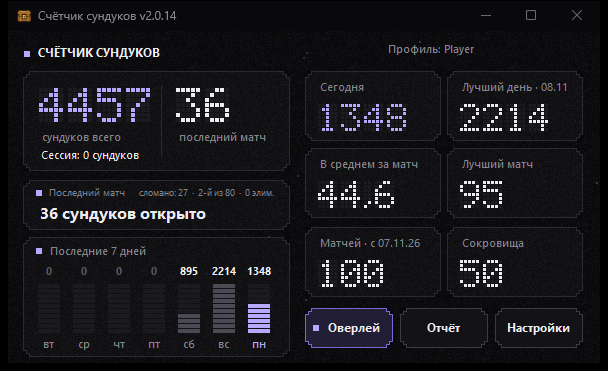
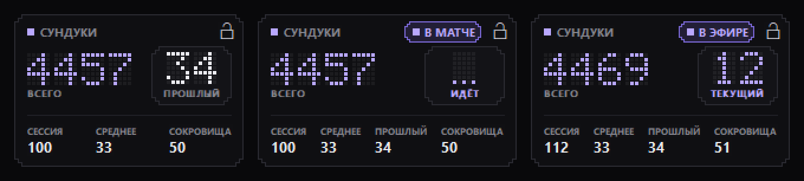
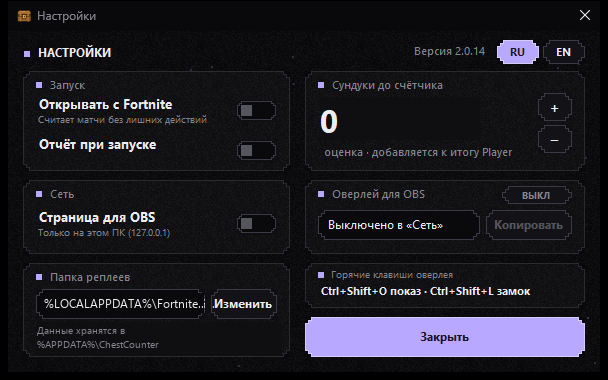
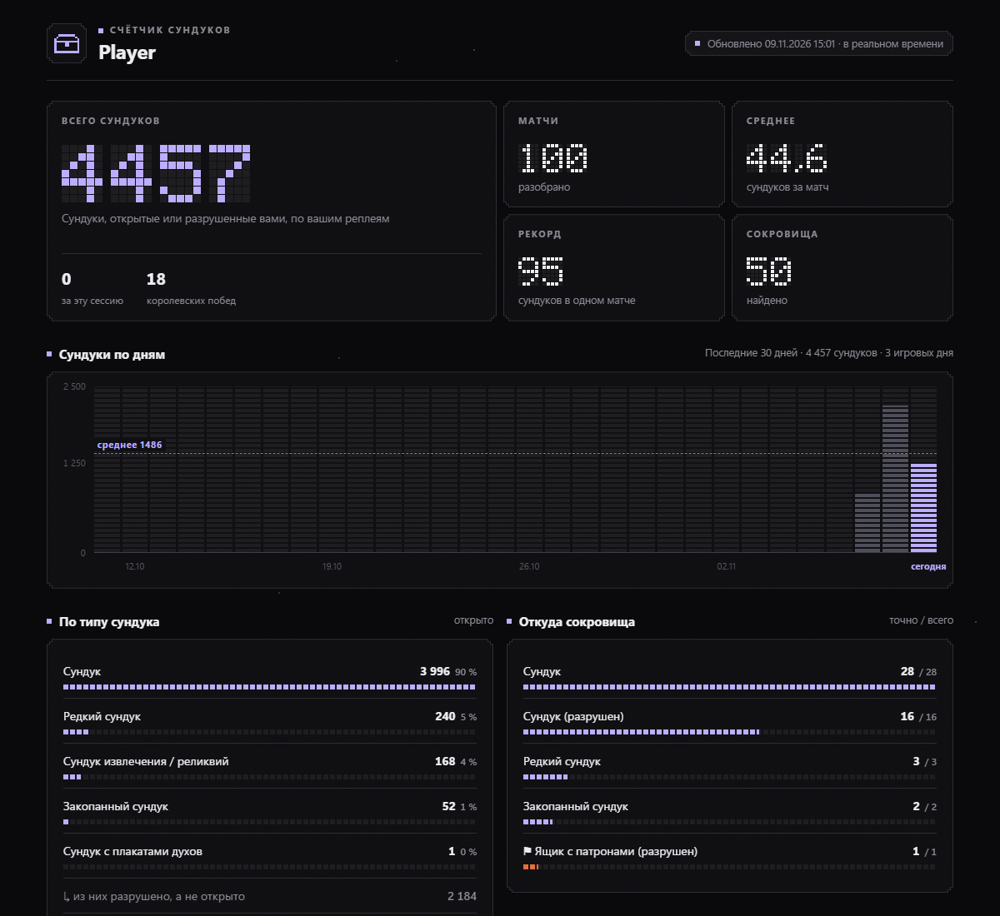

**Русский** · [English](README.en.md)

# Счётчик сундуков Fortnite

Считает сундуки, которые вы открыли в Fortnite, по файлам реплеев. Есть оверлей поверх игры и HTML-отчёт со статистикой.

Это форк [xdoofy92/ChestCounter](https://github.com/xdoofy92/ChestCounter) с русским и английским интерфейсом и без выхода в интернет.

[](https://github.com/flexeykinDev/ChestCounter/releases/latest/download/ChestCounter.exe)

**[Скачать ChestCounter.exe](https://github.com/flexeykinDev/ChestCounter/releases/latest/download/ChestCounter.exe)** · Windows 10 / 11 · без установки · [все версии](https://github.com/flexeykinDev/ChestCounter/releases)

Windows может показать «Система Windows защитила ваш компьютер», потому что exe не подписан: «Подробнее» → «Выполнить в любом случае». Если не доверяете готовому файлу, соберите его сами (см. «Сборка»).





## Что изменено в форке

- Интерфейс на русском и английском. По умолчанию русский, английский — если Windows на английском. Переключается в настройках (RU / EN) или флагом `--lang ru|en`.
- Убрано автообновление. Оригинал проверял GitHub и мог сам скачать и подменить exe. Теперь программа вообще не ходит в сеть.
- Новый вид: тёмный пиксельный интерфейс, цифры из точек, один акцентный цвет. Окно, оверлей, отчёт и страница для OBS в одном стиле.
- Страница для OBS (`http://localhost:7373/`) выключена по умолчанию. Включается в настройках, слушает только 127.0.0.1.



## Как работает

Fortnite сохраняет реплей каждого матча в `%LOCALAPPDATA%\FortniteGame\Saved\Demos`. Программа читает эти файлы (только чтение) после окончания матча. В процесс игры она не лезет, файлы игры не трогает, аккаунт Epic не нужен.

В Fortnite должна быть включена запись повторов: Настройки → Игра → Повторы.

Данные лежат в `%APPDATA%\ChestCounter`. Кнопка «Отчёт» открывает статистику в браузере:



## Безопасность: проверка по коду

Здесь не обещания, а конкретные строки кода и команды, которые можно запустить самому. Ссылки ведут на коммит [`5cb5348`](https://github.com/flexeykinDev/ChestCounter/tree/5cb5348a64477744a83e97262e7ed5ab1dd4083c), поэтому не съезжают при новых правках.

| Что | Как устроено | Где в коде |
|---|---|---|
| Интернет | Исходящих соединений нет. Автообновление из оригинала удалено целиком. | [коммит с удалением](https://github.com/flexeykinDev/ChestCounter/commit/fb31696) |
| Сервер для OBS | Единственный сетевой код. Слушает только `127.0.0.1`, на запросы от других сайтов отвечает 403. По умолчанию выключен. | [ObsServer.cs#L33](https://github.com/flexeykinDev/ChestCounter/blob/5cb5348a64477744a83e97262e7ed5ab1dd4083c/src/ChestCounter/ObsServer.cs#L33), [#L59-L61](https://github.com/flexeykinDev/ChestCounter/blob/5cb5348a64477744a83e97262e7ed5ab1dd4083c/src/ChestCounter/ObsServer.cs#L59-L61), [#L104-L108](https://github.com/flexeykinDev/ChestCounter/blob/5cb5348a64477744a83e97262e7ed5ab1dd4083c/src/ChestCounter/ObsServer.cs#L104-L108), [Monitor.cs#L94](https://github.com/flexeykinDev/ChestCounter/blob/5cb5348a64477744a83e97262e7ed5ab1dd4083c/src/ChestCounter/Monitor.cs#L94) |
| Чтение файлов | Реплеи открываются только на чтение. Других чужих файлов программа не читает. | [Tracker.cs#L372](https://github.com/flexeykinDev/ChestCounter/blob/5cb5348a64477744a83e97262e7ed5ab1dd4083c/src/ChestCounter/Tracker.cs#L372), [FortniteReplayReader.cs#L30](https://github.com/flexeykinDev/ChestCounter/blob/5cb5348a64477744a83e97262e7ed5ab1dd4083c/lib/FortniteReplayReader/FortniteReplayReader.cs#L30) |
| Запись файлов | Только в свою папку `%APPDATA%\ChestCounter`. В `errors.log` имя пользователя Windows заменяется на `<user>`. | [Models.cs#L202](https://github.com/flexeykinDev/ChestCounter/blob/5cb5348a64477744a83e97262e7ed5ab1dd4083c/src/ChestCounter/Models.cs#L202), [ErrorLog.cs#L40](https://github.com/flexeykinDev/ChestCounter/blob/5cb5348a64477744a83e97262e7ed5ab1dd4083c/src/ChestCounter/ErrorLog.cs#L40) |
| Игра | Программа только проверяет по имени, запущен ли `FortniteClient-Win64-Shipping`. Памяти игры она не касается. | [FortniteWatch.cs#L26](https://github.com/flexeykinDev/ChestCounter/blob/5cb5348a64477744a83e97262e7ed5ab1dd4083c/src/ChestCounter/FortniteWatch.cs#L26) |
| Запуск программ | Запускает только саму себя (фоновый режим «Открывать с Fortnite») и открывает `report.html` в браузере. | [FortniteWatch.cs#L81](https://github.com/flexeykinDev/ChestCounter/blob/5cb5348a64477744a83e97262e7ed5ab1dd4083c/src/ChestCounter/FortniteWatch.cs#L81), [#L143](https://github.com/flexeykinDev/ChestCounter/blob/5cb5348a64477744a83e97262e7ed5ab1dd4083c/src/ChestCounter/FortniteWatch.cs#L143), [MainForm.cs#L396](https://github.com/flexeykinDev/ChestCounter/blob/5cb5348a64477744a83e97262e7ed5ab1dd4083c/src/ChestCounter/MainForm.cs#L396) |
| Реестр | Одна запись `HKCU\...\CurrentVersion\Run\ChestCounter`. Создаётся только при включённом «Открывать с Fortnite» и удаляется при выключении. | [FortniteWatch.cs#L49-L61](https://github.com/flexeykinDev/ChestCounter/blob/5cb5348a64477744a83e97262e7ed5ab1dd4083c/src/ChestCounter/FortniteWatch.cs#L49-L61) |
| Клавиатура | Две горячие клавиши через `RegisterHotKey`. Хуков клавиатуры и перехвата нажатий нет. | [NativeOverlay.cs#L261-L262](https://github.com/flexeykinDev/ChestCounter/blob/5cb5348a64477744a83e97262e7ed5ab1dd4083c/src/ChestCounter/NativeOverlay.cs#L261-L262) |
| Системные вызовы | Только `user32`, `gdi32`, `kernel32` и `dwmapi`: окна, рисование, консоль, режим эффективности. Из `kernel32` используются `GetConsoleWindow`, `AllocConsole`, `AttachConsole`, `GetStdHandle`, `GetFileType`, `GetCurrentProcess`, `SetProcessInformation` и `GetModuleHandleW`. | команда 5 ниже |
| Чужой код | Ничего не скачивается и не подгружается, зашифрованных или base64-вставок нет. Единственный пакет — `Microsoft.Extensions.Logging.Abstractions` от Microsoft. Библиотека разбора реплеев совпадает с [Shiqan/FortniteReplayDecompressor@76f74c1](https://github.com/Shiqan/FortniteReplayDecompressor/tree/76f74c1), отличия перечислены в [PATCHES.md](lib/PATCHES.md). `DynamicMethod` в [NetFieldParser.cs#L134](https://github.com/flexeykinDev/ChestCounter/blob/5cb5348a64477744a83e97262e7ed5ab1dd4083c/lib/Unreal.Core/NetFieldParser.cs#L134) пришёл из оригинальной библиотеки: он ускоряет запись разобранных полей и ничего не загружает. | команды 4 и 7 |
| Сборка | В `.csproj` нет команд, которые выполняются при сборке. | команда 6 |

### Проверить самому

Склонируйте репозиторий и запустите команды в его папке (Git Bash или PowerShell, нужен только git):

```bash
# 1. Весь сетевой код. Ожидается: только src/ChestCounter/ObsServer.cs
git grep -n -E "HttpClient|WebClient|WebRequest|TcpClient|TcpListener|UdpClient|System\.Net\.Sockets|Dns\." -- "*.cs"

# 2. То, что ищут стиллеры: браузеры, Discord, Telegram, кошельки, вебхуки. Ожидается: пусто
git grep -n -i -w -e "Login Data" -e "Local State" -e "User Data" -e leveldb -e discord -e tdata -e telegram -e wallet -e Cookies -e webhook -e Firefox -e Google -- "*.cs"

# 3. Чтение чужой памяти, инъекции, кейлоггер, расшифровка паролей. Ожидается: пусто
git grep -n -E "OpenProcess|ReadProcessMemory|WriteProcessMemory|VirtualAlloc|CreateRemoteThread|SetWindowsHookEx|GetAsyncKeyState|SendInput|CryptUnprotectData|ProtectedData" -- "*.cs"

# 4. Загрузка кода на лету, запуск консоли, base64. Ожидается: пусто
git grep -n -E "Assembly\.Load|LoadLibrary|GetProcAddress|powershell|cmd\.exe|FromBase64String" -- "*.cs"

# 5. Какие системные библиотеки вызываются. Ожидается: user32, gdi32, kernel32, dwmapi
git grep -h -o -E "DllImport..[a-z0-9]+\.dll" -- "*.cs"

# 6. Команды, выполняемые при сборке. Ожидается: пусто
git grep -n -E "<Exec|<Target |PreBuildEvent|PostBuildEvent" -- "*.csproj" "*.props"

# 7. Пакеты из интернета. Ожидается: только Microsoft.Extensions.Logging.Abstractions
git grep -n "PackageReference" -- "*.csproj"
```

Готовые exe не подписаны, поэтому надёжнее собрать программу самому: `build.bat` собирает её из этих исходников.

## Сборка

Нужен [.NET 10 SDK](https://dotnet.microsoft.com/download/dotnet/10.0). Запустите `build.bat`, готовый файл будет в `dist\ChestCounter.exe`.

## Горячие клавиши

| Клавиши | Что делает |
|---|---|
| Ctrl+Shift+O | показать / скрыть оверлей |
| Ctrl+Shift+L | закрепить / открепить оверлей (закреплённый пропускает клики) |

Чтобы оверлей был виден в игре, поставьте в Fortnite оконный полноэкранный режим.

## Лицензия

MIT, как и оригинал. Разбор реплеев основан на [FortniteReplayDecompressor](https://github.com/Shiqan/FortniteReplayDecompressor) (MIT), список правок в [lib/PATCHES.md](lib/PATCHES.md).
